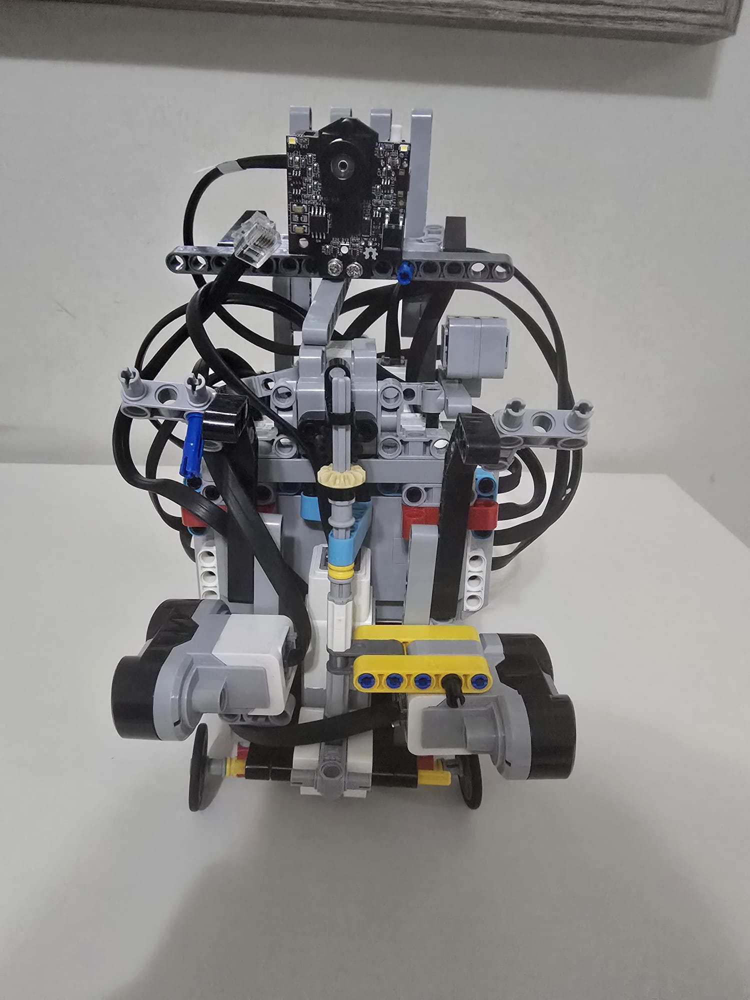
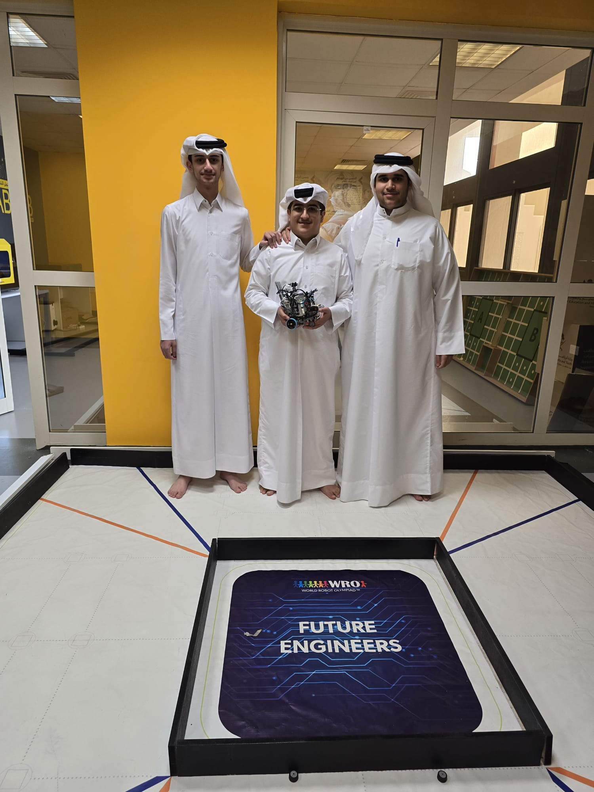
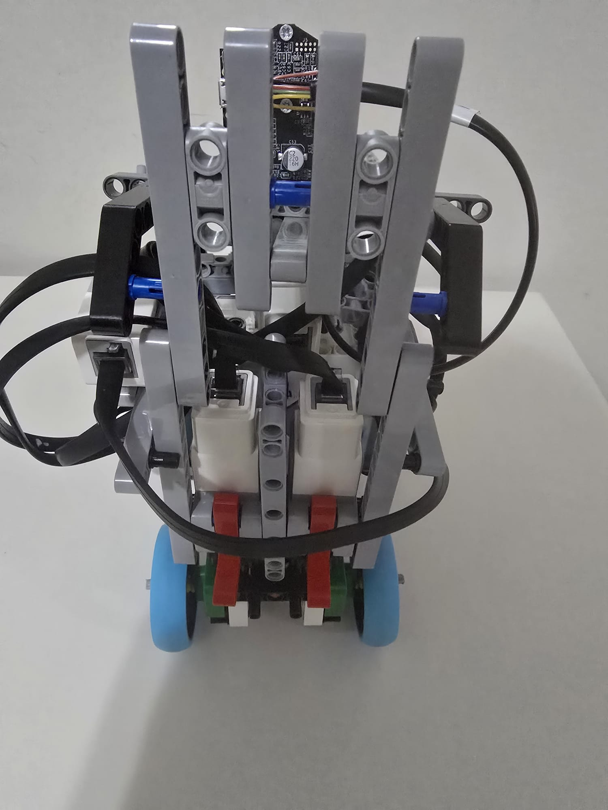
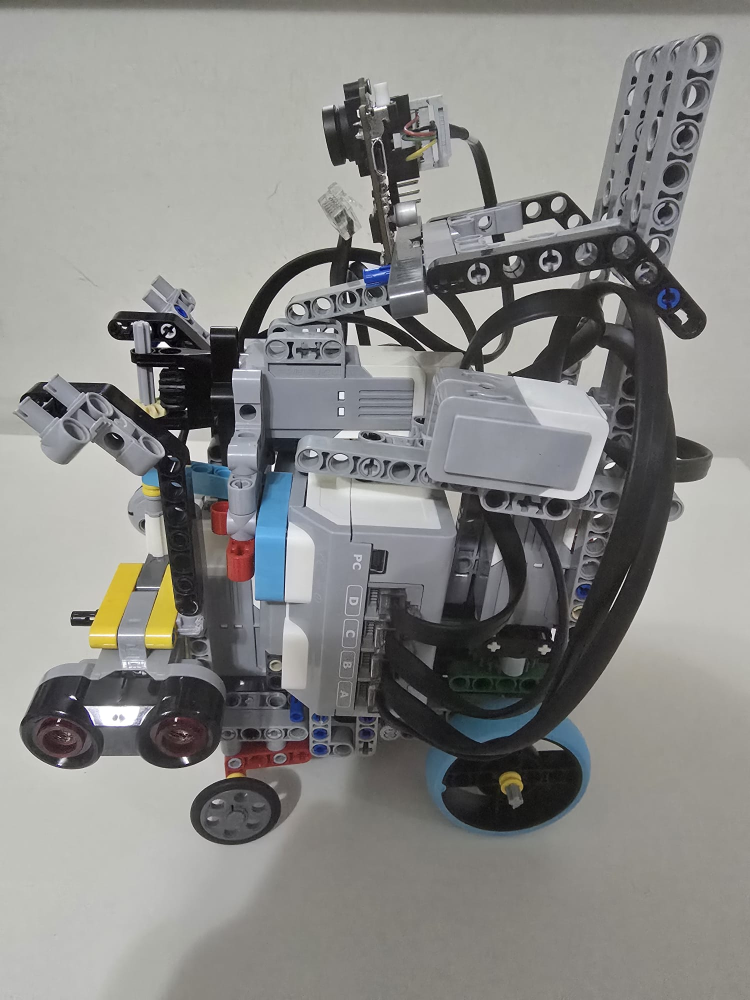
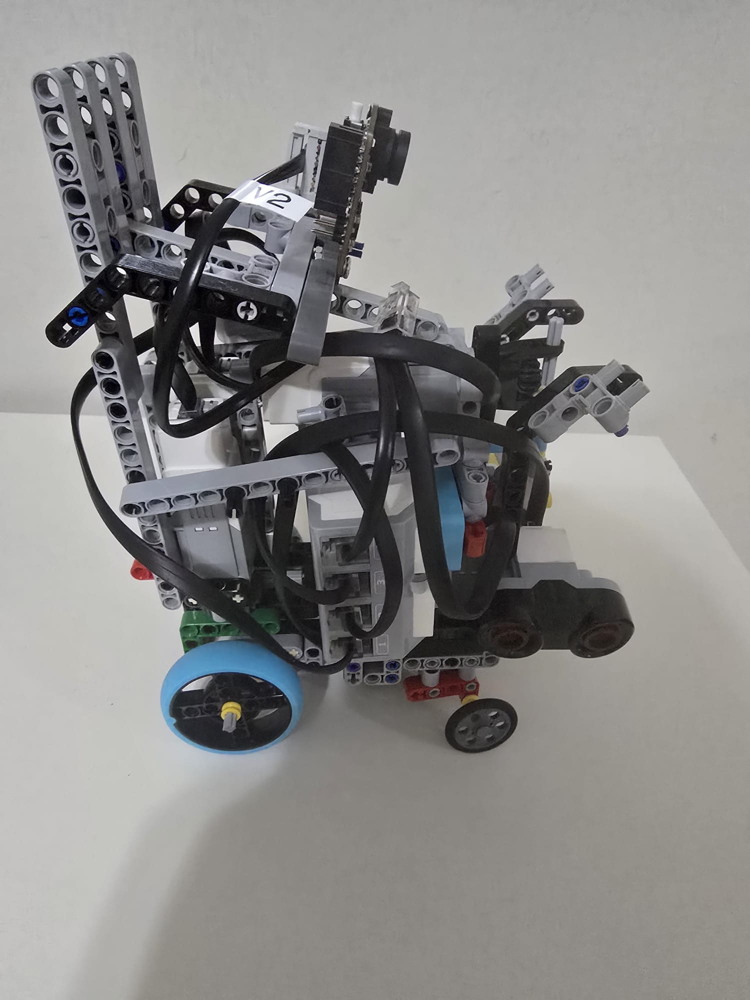
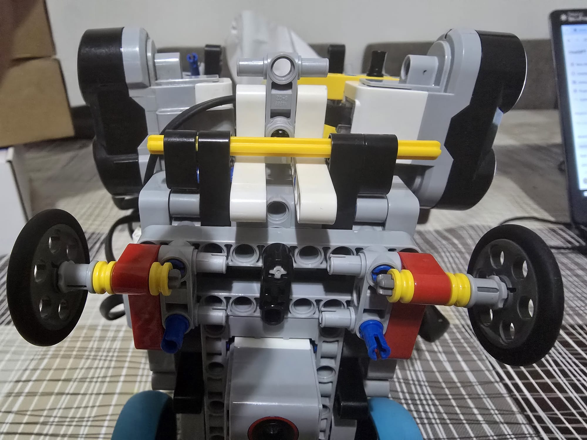

# Qatar FE — Team 6038 · WRO Future Engineers 2026

<p align="center">
  
</p>

Hi! We are **Team 6038** from Qatar. This is the repository for our self-driving car for the **WRO 2026 Future Engineers** challenge. Our car is built on a **LEGO MINDSTORMS EV3**, uses two ultrasonic sensors and a gyro to drive around the track, and a **Pixy2 camera** to see the red and green pillars.

Here you will find everything we made: our code, our drawings, our calculations, photos, videos, and the story of how the robot changed while we built it.

## The team

<p align="center">
  
</p>

| Name | What they do |
|---|---|
| Eissa | Team leader, keeps the project on track |
| Omar | Lead programmer |
| Mohammed | Lead designer, mechanics and 3D parts |

More photos (including the funny one 😄) are in [t-photos](t-photos/README.md).

## Our robot in action

| Challenge | Video |
|---|---|
| Open Challenge | [Watch on YouTube](video/README.md) |
| Obstacle Challenge | [Watch on YouTube](video/README.md) |

All video links are in [video/README.md](video/README.md).

## The robot

| Front | Back | Left | Right | Bottom |
|---|---|---|---|---|
|  |  |  |  |  |

All vehicle photos are in [v-photos](v-photos/README.md).

**Quick specs**

| Part | What we used | Port |
|---|---|---|
| Brain | LEGO EV3 running Pybricks MicroPython | |
| Drive | 2 × EV3 Medium Motor | A, B |
| Steering | 1 × EV3 Medium Motor | C |
| Heading | EV3 Gyro Sensor | S1 |
| Wall distance | 2 × EV3 Ultrasonic Sensor (left / right) | S2, S3 |
| Vision | Pixy2 camera with built-in light, over I²C (0x54) | S4 |
| Custom parts | 3 modified LEGO-style parts, 3D printed | |

## How the repository is organised

The WRO judging asks about three main topics, so we gave each one its own page:

- 🚗 [**Mobility Management**](Mobility%20Management/README.md): motors, steering, how we follow the corridor and take corners.
- 🔋 [**Power and Sense Management**](Power%20and%20Sense%20Management/README.md): power, sensors, and wiring.
- 🟥🟩 [**Obstacle Management**](Obstacle%20Management/README.md): how the Pixy2 finds the pillars and how we pass them.

Then the rest:

| Folder | What's inside |
|---|---|
| [software](software/README.md) | Our two programs (Open and Obstacle), each written in Python **and** in EV3 blocks |
| [docs/development_journal.md](docs/development_journal.md) | Our build log: what we tried, what broke, what we changed |
| [engineering](engineering/README.md) | Design notes: chassis, steering geometry, vehicle dynamics, Pixy2 geometry, risks |
| [docs/drawings](docs/drawings/README.md) | Our 8 SVG diagrams (system, wiring, steering, state machine…) |
| [hardware](hardware/README.md) | Hardware details and sensor calibration |
| [models](models/README.md) | STL files of our 3D-printed parts |
| [validation](validation/README.md) | How we test the robot and our test report template |
| [tests](tests) | Automatic checks for our Python code and calculations |
| [t-photos](t-photos/README.md) · [v-photos](v-photos/README.md) · [video](video/README.md) | Team photos, robot photos, videos |

## Our code

We wrote each challenge **twice**: once in Python (Pybricks) and once in EV3 blocks. **We compete with the EV3 blocks version**: with Python, getting the robot ready took longer than the 90 minutes allowed. We kept the Python versions because they show our logic clearly. The full story is in our [development journal](docs/development_journal.md).

| Challenge | What it does | Python | EV3 blocks |
|---|---|---|---|
| Open Challenge | Stays in the middle of the corridor, detects corners, counts laps, stops in the start section | [open_challenge.py](software/open_challenge/open_challenge.py) | [OpenChallenge.ev3](software/ev3_blocks/open_challenge/OpenChallenge.ev3) |
| Obstacle Challenge | Sees red/green pillars, passes them on the correct side, goes back to the lane, parks | [obstacle_challenge.py](software/obstacle_challenge/obstacle_challenge.py) | [ObstacleChallenge.ev3](software/ev3_blocks/obstacle_challenge/ObstacleChallenge.ev3) |

### How to put the code on the robot

**Python version**

1. Flash the **Pybricks MicroPython for EV3** image on a microSD card and boot the EV3 from it.
2. On the computer, install **VS Code** and the **LEGO MINDSTORMS EV3 MicroPython** extension.
3. Open the challenge folder in VS Code and connect the EV3 with the USB cable.
4. For the Obstacle Challenge only: copy the `pixycamev3` library folder next to `obstacle_challenge.py` so the program can talk to the Pixy2.
5. Click **Download and Run**. The program name and version show on the EV3 screen.
6. Keep the robot still during startup: the gyro calibrates first.

**EV3 blocks version**

1. Open the `.ev3` file in the **LEGO MINDSTORMS EV3** software.
2. Connect the EV3 and press **Download**.
3. Start the program from the EV3 brick menu.

### Automatic checks

Every time we push, GitHub Actions compiles our Python programs, runs our tests, and runs our calculation sweep ([workflow file](.github/workflows/python-validation.yml)). Results are in the **Actions** tab. These checks only test the code and the maths; real performance is in our videos and test logs.

To run them on your own computer:

```bash
python -m unittest discover -s tests -v
python engineering/simulation/parameter_sweep.py
```

## A note on our numbers

In our notes we always say where a number comes from:

- **Configured**: a value we set in the program.
- **Calculated**: worked out with an equation.
- **Measured**: we measured it on the real robot (with a test record).

That way nobody (including us!) mixes up a value we *want* with a value we actually *got*.
