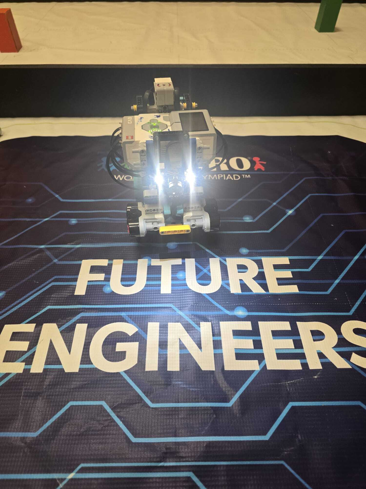
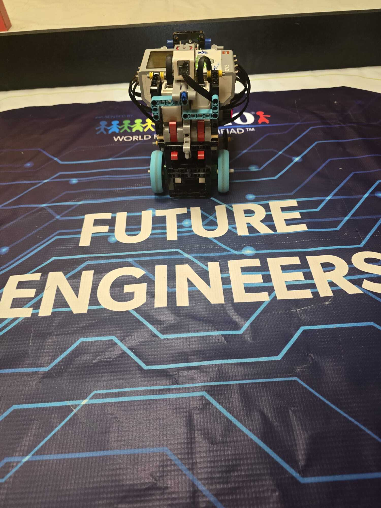
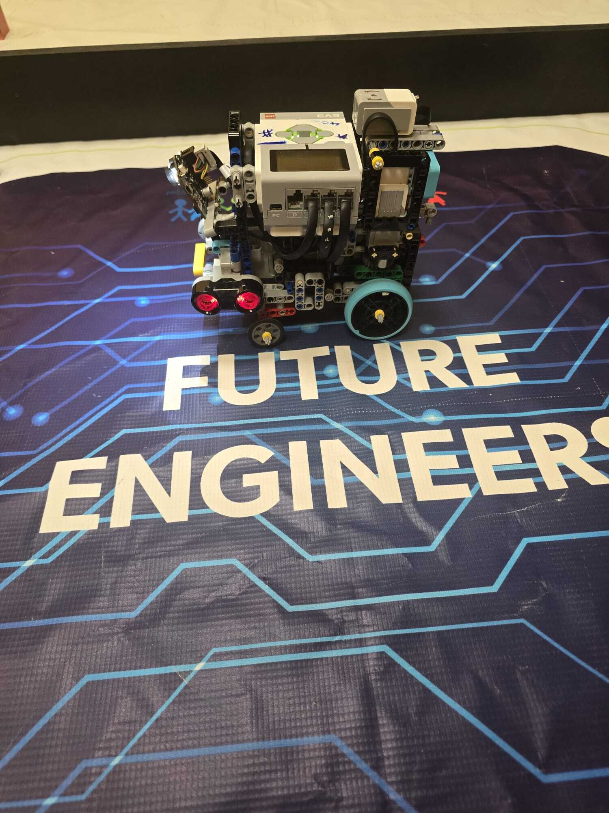
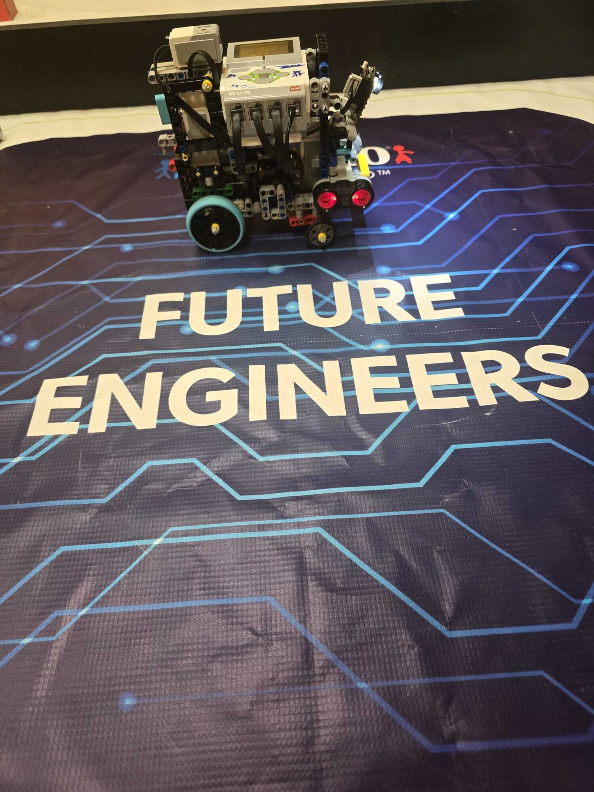
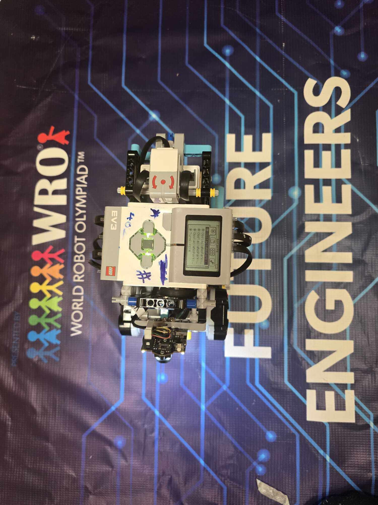
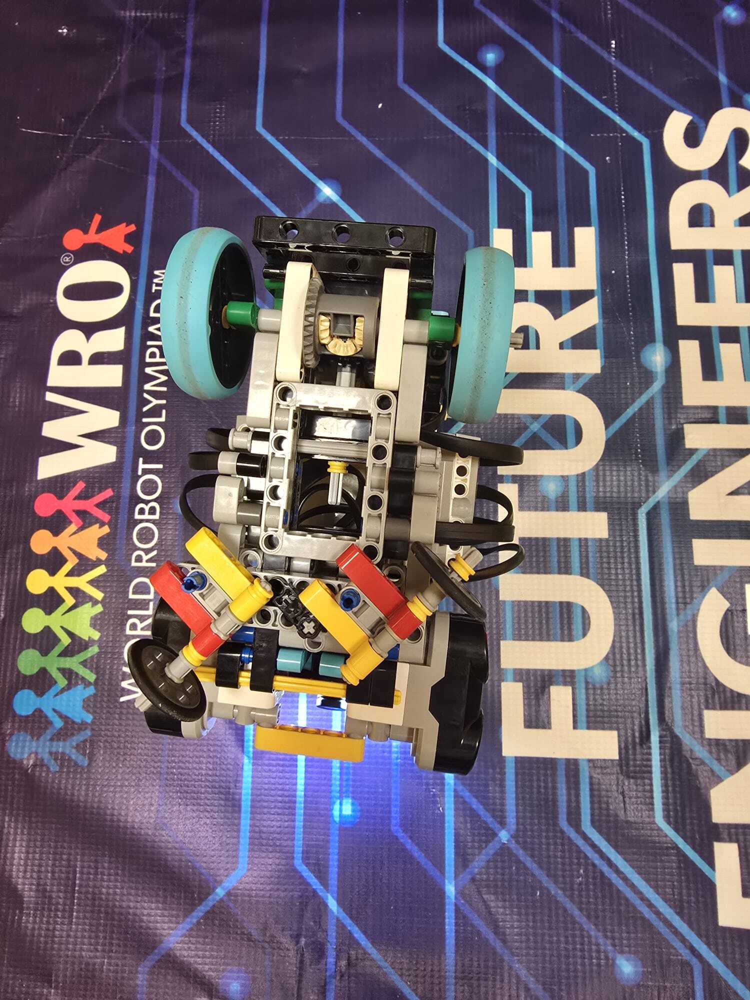

# Our Robot

Here is our car from every side. It runs on a LEGO EV3 with two drive motors, one steering motor, a gyro, two ultrasonic sensors, and a Pixy2 camera on top for the pillars.

| Front | Back |
|---|---|
|  |  |

| Left | Right |
|---|---|
|  |  |

| Top | Bottom |
|---|---|
|  |  |

## Extra shots

| Bottom with the steering turned |
|---|
|  |

You can see how the steering works in the first one: the steering motor moves both front wheels together through the red linkage parts.

Want the details? Check [Hardware](../hardware/README.md) and [Engineering](../engineering/README.md).
